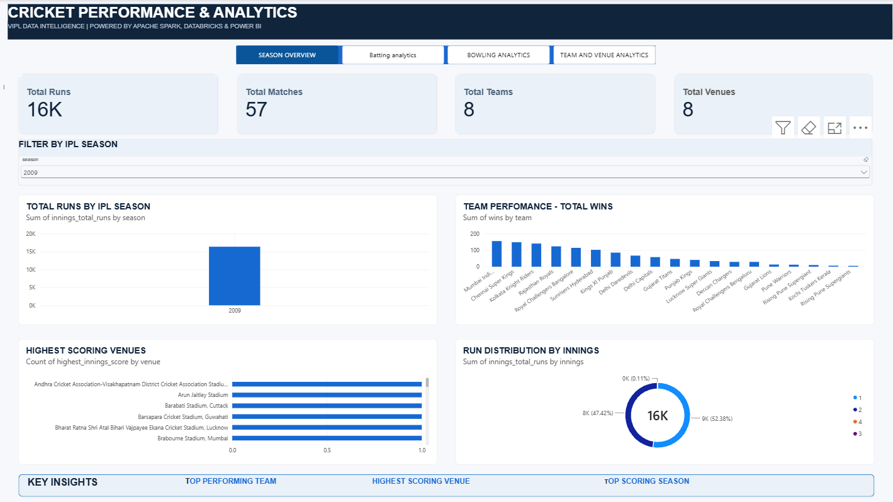
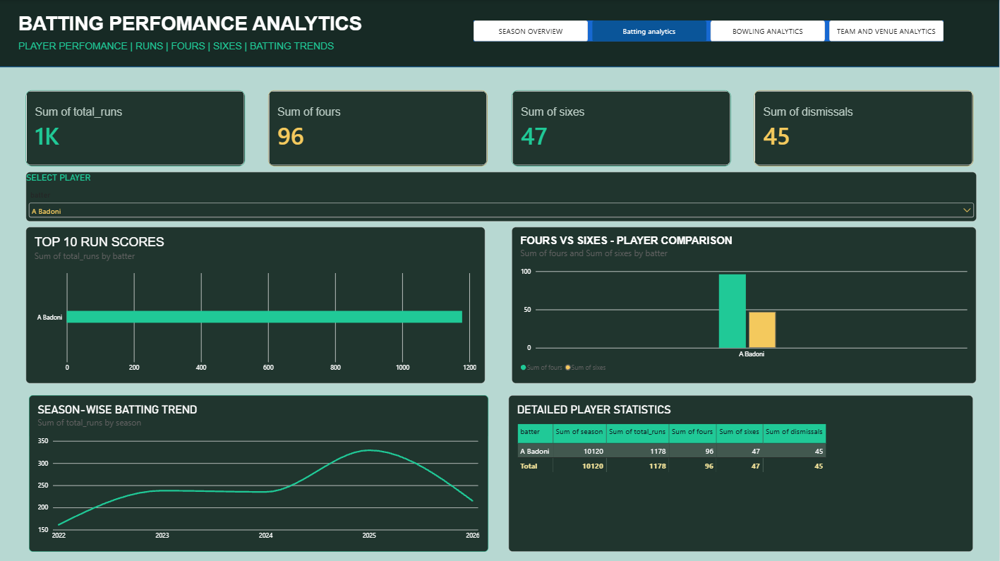
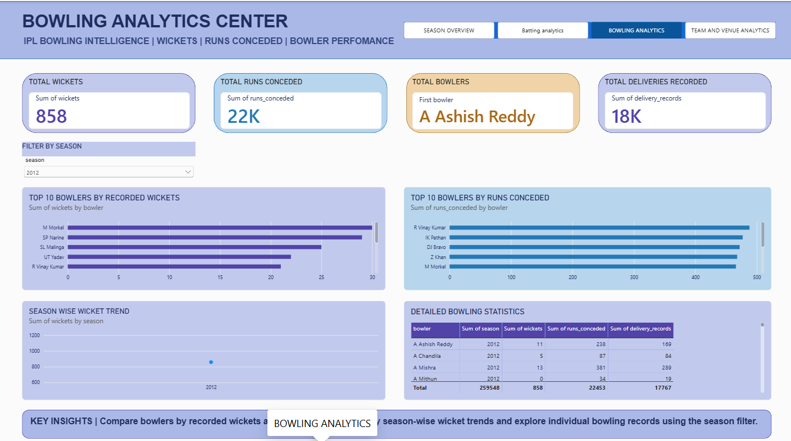
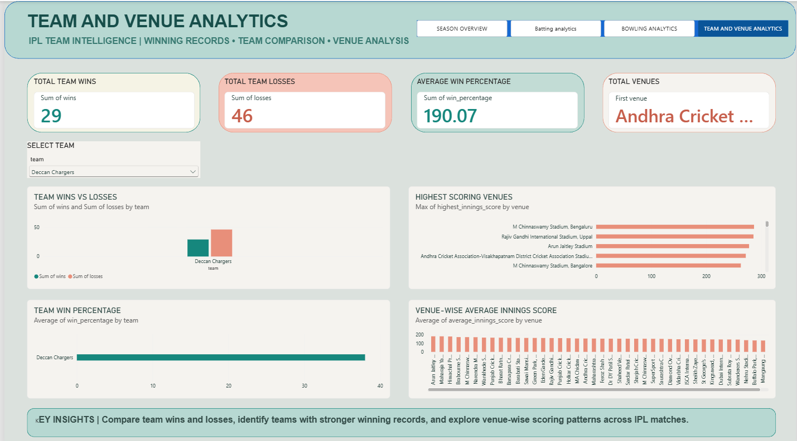

# 🏏 Cricket Performance & Analytics
### An End-to-End Data Engineering and Business Intelligence Platform

<p align="center">
  
  
  
  
  
</p>

---

## 📌 Project Overview

**Cricket Performance & Analytics** is an end-to-end Big Data Analytics project designed to transform IPL cricket match data into meaningful, structured, and interactive business intelligence.

The platform processes ball-by-ball cricket data to analyze batting performance, bowling statistics, team results, seasonal trends, and venue-based scoring patterns.

Using Python, Apache Spark, Databricks, Delta Lake, and Microsoft Power BI, the project implements a structured data engineering pipeline based on the **Medallion Architecture**.

The ultimate goal is to convert raw cricket data into actionable insights through data processing, analytical transformations, and interactive visualizations.

---

## 🎯 Project Objectives

- Extract and process IPL ball-by-ball cricket data.
- Build an end-to-end Big Data processing pipeline.
- Implement Bronze, Silver, and Gold data layers.
- Perform data cleaning, validation, and transformation using PySpark.
- Analyze player batting and bowling performance.
- Compare team wins, losses, and winning percentages.
- Identify venue-wise scoring patterns.
- Develop interactive Power BI dashboards for data-driven analysis.

---

## ⭐ Key Features

| Feature | Description |
|---|---|
| Data Extraction | Extracts match and delivery-level data from Cricsheet JSON files |
| Data Ingestion | Loads raw datasets into Databricks |
| Data Cleaning | Handles missing values, duplicates, and data validation |
| Medallion Architecture | Organizes data into Bronze, Silver, and Gold layers |
| Batting Analytics | Analyzes runs, fours, sixes, and dismissals |
| Bowling Analytics | Explores recorded wickets and runs conceded |
| Team Analytics | Compares team wins, losses, and winning percentages |
| Venue Analytics | Examines average and highest innings scores |
| Interactive Dashboard | Presents insights through four Power BI report pages |

---

## 🏗️ System Architecture

The project follows the **Medallion Architecture**, a multi-layered data engineering approach.

### Data Engineering Workflow

```text
             CRICSHEET IPL DATASET
                       |
                       ▼
               PYTHON EXTRACTION
                       |
              JSON PARSING & VALIDATION
                       |
                       ▼
                 CSV DATA FILES
                       |
                       ▼
              DATABRICKS + PYSPARK
                       |
          ┌────────────┴────────────┐
          ▼                         |
    BRONZE LAYER                    |
    Raw Data Ingestion              |
          |                         |
          ▼                         |
    SILVER LAYER                    |
    Data Cleaning                   |
    Validation & Transformation     |
          |                         |
          ▼                         |
    GOLD LAYER                      |
    Analytical Aggregations         |
          |                         |
          ▼                         |
       DELTA TABLES                 |
          |                         |
          ▼                         |
      MICROSOFT POWER BI            |
          |                         |
          ▼                         |
    INTERACTIVE DASHBOARDS
```

### Medallion Architecture

**🥉 Bronze Layer – Raw Data Ingestion**
- Ingests extracted cricket datasets.
- Preserves source information.
- Adds ingestion metadata.
- Stores raw data in Delta format.

**🥈 Silver Layer – Data Cleaning**
- Removes duplicate records.
- Handles null values in essential fields.
- Validates cricket data.
- Prepares structured datasets for analysis.

**🥇 Gold Layer – Business Analytics**
- Generates analytical aggregations.
- Calculates batting and bowling statistics.
- Produces team and venue performance summaries.
- Prepares datasets for Power BI reporting.

---

## 🛠️ Technology Stack

| Technology | Purpose |
|---|---|
| Python | Data extraction and preprocessing |
| Apache Spark | Distributed data processing |
| PySpark | Data cleaning and transformation |
| Databricks | Cloud-based data engineering environment |
| Delta Lake | Structured data storage |
| Microsoft Power BI | Business intelligence and visualization |
| GitHub | Version control and project documentation |
| CSV / JSON | Data formats |

---

## 📊 POWER BI DASHBOARD SHOWCASE

The project features four interactive dashboard pages developed using Microsoft Power BI.

### 01. Season Overview

Provides a consolidated view of IPL performance through key performance indicators, season-wise scoring trends, team wins, venue records, and innings distribution.



### 02. Batting Analytics

Explores individual batting performance through total runs, fours, sixes, dismissals, top run scorers, and season-wise batting trends.



### 03. Bowling Analytics

Presents bowling performance through recorded wickets, runs conceded, bowler comparisons, and season-wise wicket trends.



### 04. Team & Venue Analytics

Analyzes team wins and losses, winning percentages, highest-scoring venues, and average innings scores across venues.



---

## 📁 Repository Structure

```text
Cricket-Analytics/
│
├── extraction/
│   ├── extract_data.py
│   ├── extract_matches.py
│   └── README.md
│
├── notebooks/
│   ├── 01_Bronze_Cricket_Ingestion.py
│   ├── 02_Silver_Cricket_Cleaning.py
│   ├── 03_Gold_Cricket_Analytics.py
│   └── README.md
│
├── dashboard/
│   ├── Cricket_Analytics_Dashboard.pbix
│   │
│   ├── powerbi_data/
│   │   ├── gold_batting_stats.csv
│   │   ├── gold_bowling_stats.csv
│   │   ├── gold_team_innings.csv
│   │   ├── gold_venue_stats.csv
│   │   ├── gold_phase_analysis.csv
│   │   └── gold_team_performance.csv
│   │
│   ├── screenshots/
│   │   ├── season_overview.png
│   │   ├── batting_analytics.png
│   │   ├── bowling_analytics.png
│   │   └── team_venue_analytics.png
│   │
│   └── README.md
│
├── docs/
│   └── README.md
│
└── README.md
```

---

## 📂 Dataset Information

**Dataset Source:** Cricsheet

Website: https://cricsheet.org/

The project uses IPL ball-by-ball JSON match data from Cricsheet.

The dataset contains information related to:

- Match details and seasons.
- Batting and bowling records.
- Individual deliveries and innings.
- Runs, extras, and dismissals.
- Teams, players, and venues.

The extracted match dataset contains 1,243 match records.

---

## 📈 Analytical Outputs

The Gold layer produces six analytical datasets:

| Dataset | Analytical Purpose |
|---|---|
| gold_batting_stats | Player batting performance |
| gold_bowling_stats | Bowling performance |
| gold_team_innings | Team innings and scoring analysis |
| gold_venue_stats | Venue-based scoring analysis |
| gold_phase_analysis | Powerplay, middle-over, and death-over analysis |
| gold_team_performance | Team wins, losses, and winning percentages |

These datasets serve as the analytical foundation for the Power BI dashboards.

---

## 🔄 End-to-End Project Workflow

1. **Data Collection:** Obtain IPL JSON datasets from Cricsheet.
2. **Data Extraction:** Use Python scripts to parse JSON files and generate structured CSV datasets.
3. **Data Ingestion:** Upload datasets to Databricks.
4. **Bronze Processing:** Ingest raw data into Delta tables.
5. **Silver Processing:** Clean, validate, and transform the data using PySpark.
6. **Gold Processing:** Generate analytical datasets and aggregations.
7. **Data Visualization:** Import Gold-layer datasets into Microsoft Power BI.
8. **Dashboard Development:** Create interactive reports for cricket performance analysis.
9. **Documentation:** Maintain project scripts, notebooks, datasets, and dashboard files in GitHub.

---

## 🚀 Project Outcomes

The project demonstrates the implementation of an end-to-end Big Data Analytics workflow, combining data extraction, distributed processing, structured storage, analytical transformations, and business intelligence.

It provides an organized approach to exploring cricket performance across players, teams, seasons, and venues.

---

## 👥 Project Team

**Team Name:** Team Cloud Crusaders

**Project Title:** Cricket Performance and Analytics: An End-to-End Data Engineering and Business Intelligence Platform

**Project Domain:** Big Data Analytics

---

## 🔮 Future Enhancements

- Integration of additional cricket data sources.
- Real-time cricket match analytics.
- Advanced player performance prediction.
- Machine learning-based match outcome prediction.
- Enhanced player comparison and performance metrics.
- Automated data ingestion and dashboard refresh.

---

## 📥 Access the Power BI Dashboard

The complete Power BI report is available in the repository:

**[Open / Download Cricket Analytics Dashboard (.pbix)](dashboard/Cricket_Analytics_Dashboard.pbix)**

---

<p align="center">
  <b>CRICKET PERFORMANCE & ANALYTICS</b><br/>
  Transforming Cricket Data into Meaningful Insights.
</p>
